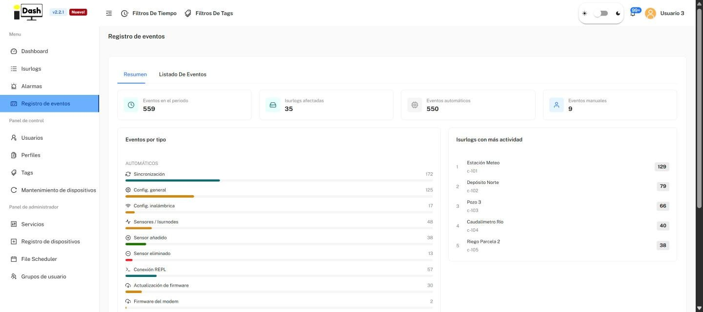
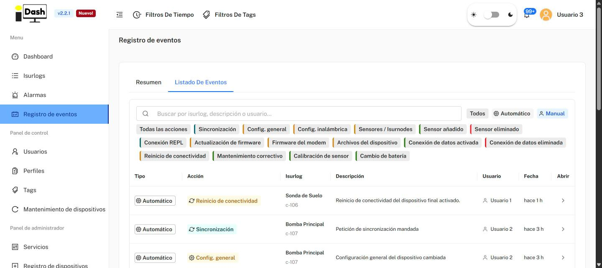
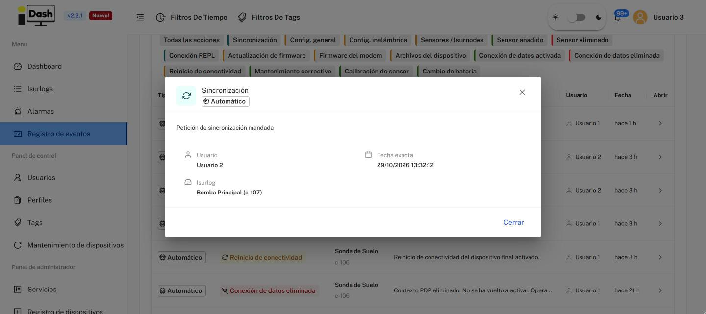

# 6.5. Registro de Eventos

La página **Registro de eventos** es el historial de actividad de la flota: todo lo que les ocurre a los ISURLOG además de las alarmas. Incluye sincronizaciones, cambios de configuración, sensores añadidos o eliminados, actualizaciones de firmware, consolas remotas, eventos de conectividad y trabajos de mantenimiento manuales. Para las alarmas, ver [6.4. Alarmas](isurdash-alarms.md).

Los eventos de un solo dispositivo también están en su propia pestaña **Registros** (ver [6.3.5](isurdash-devices.md#635-registros-alarmas-y-eventos)). Esta página los muestra para todos los dispositivos a la vez.

La página tiene dos pestañas: **Resumen** y **Listado De Eventos**. Como el resto de la plataforma, ambas siguen los **Filtros de tiempo** y los **Filtros de Tags** globales de la barra superior (ver [6. Plataforma IsurDASH](isurdash-platform.md)).

## Resumen

Cuatro indicadores resumen el periodo:

* **Eventos en el periodo:** número total de eventos.
* **Isurlogs afectadas:** cuántos dispositivos distintos tuvieron al menos un evento.
* **Eventos automáticos:** eventos generados por la plataforma o por el propio dispositivo.
* **Eventos manuales:** eventos registrados por una persona.

Debajo de los indicadores hay dos paneles:

* **Eventos por tipo:** una barra por cada tipo de evento con su número de eventos, agrupados en **AUTOMÁTICOS** y **MANUALES**. Los tipos se describen en la tabla de abajo.
* **Isurlogs con más actividad:** un ranking de los dispositivos con más eventos, con su nombre, ID y número de eventos.

{width="1000"}

*La pestaña Resumen — indicadores, eventos por tipo y dispositivos con más actividad (datos de ejemplo).*

## Tipos de evento

| Tipo | Modo | Qué registra |
| :--- | :--- | :--- |
| **Sincronización** | Automático | Se envió una petición de sincronización al dispositivo. |
| **Config. general** | Automático | Se cambió la configuración general del dispositivo. |
| **Config. inalámbrica** | Automático | Se cambió la configuración inalámbrica. |
| **Sensores / Isurnodes** | Automático | Cambios en los sensores o en los Isurnodes del dispositivo. |
| **Sensor añadido** | Automático | Se añadió un sensor al dispositivo. |
| **Sensor eliminado** | Automático | Se eliminó un sensor del dispositivo. |
| **Conexión REPL** | Automático | Se abrió una sesión REPL en el dispositivo (ver [6.9. Mantenimiento de Dispositivos](isurdash-maintenance.md)). |
| **Actualización de firmware** | Automático | Se actualizó el firmware del ESP32. |
| **Firmware del modem** | Automático | Se actualizó el firmware del módem. |
| **Archivos del dispositivo** | Automático | Actividad sobre los archivos del dispositivo. |
| **Conexión de datos activada** | Automático | El dispositivo estableció una nueva conexión de datos. La descripción incluye el operador y, cuando corresponde, cuánto tiempo estuvo el dispositivo sin conexión de datos. |
| **Conexión de datos eliminada** | Automático | Se cortó una conexión de datos. La descripción incluye el operador e indica si no se volvió a activar después. |
| **Reinicio de conectividad** | Automático | Se reinició la conectividad del dispositivo. |
| **Mantenimiento correctivo** | Manual | Una tarea de mantenimiento correctivo, registrada a mano. |
| **Calibración de sensor** | Manual | Una calibración de sensor, registrada a mano. |
| **Cambio de batería** | Manual | Un cambio de batería, registrado a mano. |

Los eventos manuales se crean desde la pestaña **Registros** del propio dispositivo, con el botón **Registrar evento manual** (ver [6.3.5](isurdash-devices.md#635-registros-alarmas-y-eventos)).

## Listado De Eventos

El historial completo, con los eventos más recientes primero. En la parte superior de la pestaña:

* **Cuadro de búsqueda:** busca eventos por Isurlog, descripción o usuario.
* **Todos / Automático / Manual:** filtra por el modo del evento.
* **Etiquetas de tipo:** filtran por tipo de evento. **Todas las acciones** muestra todos los tipos; las demás son las de la tabla de arriba.

La tabla tiene estas columnas:

* **Tipo:** si el evento es **Automático** o **Manual**.
* **Acción:** el tipo de evento.
* **Isurlog:** el nombre y el ID del dispositivo.
* **Descripción:** qué ocurrió.
* **Usuario:** el usuario al que se atribuye el evento.
* **Fecha:** hace cuánto ocurrió (por ejemplo, "hace 3 h").
* **Abrir:** abre una ventana con la descripción completa, el usuario, la **fecha y hora exactas** y el Isurlog.

Al final de la tabla eliges cuántas filas mostrar por página (15 por defecto) y ves el número total de eventos.

{width="1000"}

*La pestaña Listado De Eventos — búsqueda, filtros y tabla de eventos (datos de ejemplo).*

{width="1000"}

*La ventana de detalle que se abre con el botón Abrir (datos de ejemplo).*
