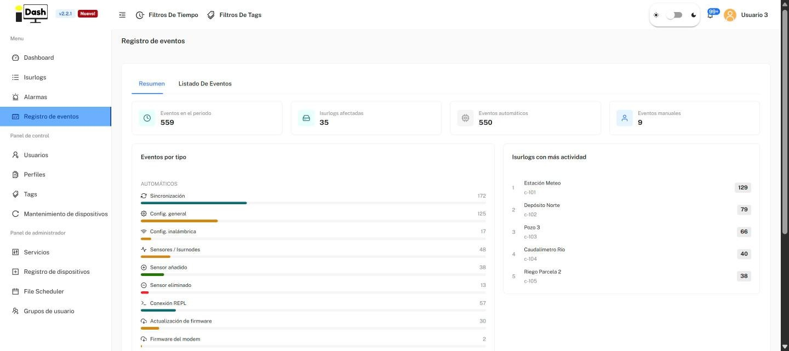
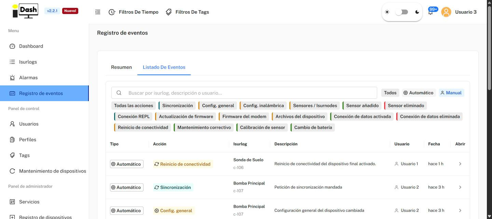
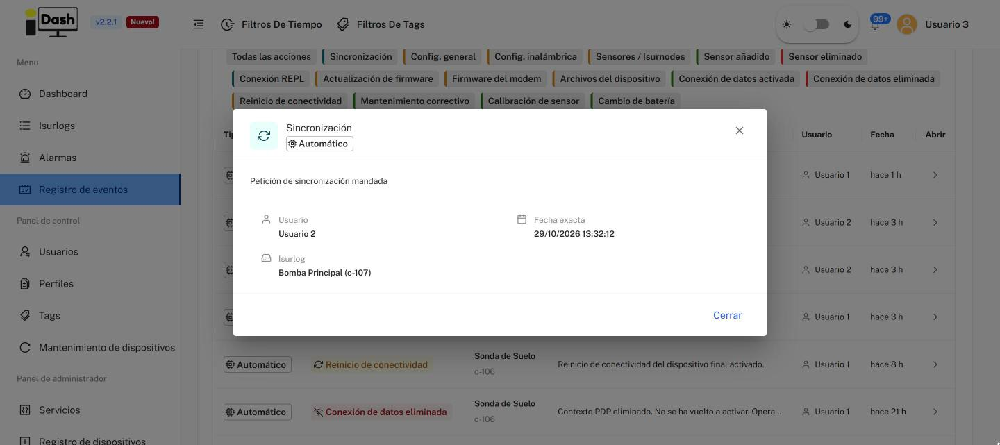

# 6.5. Event Log

The **Registro de eventos** page is the activity history of the fleet: everything that happens to the ISURLOGs besides alarms. That includes synchronizations, configuration changes, sensors added or removed, firmware updates, remote consoles, connectivity events and manual maintenance work. For alarms, see [6.4. Alarms](isurdash-alarms.md).

The events of a single device are also available in its own **Registros** tab (see [6.3.5](isurdash-devices.md#635-registros-alarms-and-events)). This page shows them for all devices at once.

The page has two tabs: **Resumen** and **Listado De Eventos**. Like the rest of the platform, both follow the global **Filtros de tiempo** and **Filtros de Tags** in the top bar (see [6. IsurDASH Platform](isurdash-platform.md)).

## Resumen

Four indicators sum up the period:

* **Eventos en el periodo:** total number of events.
* **Isurlogs afectadas:** how many different devices had at least one event.
* **Eventos automáticos:** events generated by the platform or by the device itself.
* **Eventos manuales:** events logged by a person.

Below the indicators there are two panels:

* **Eventos por tipo:** one bar per event type with its number of events, grouped as **AUTOMÁTICOS** and **MANUALES**. The types are described in the table below.
* **Isurlogs con más actividad:** a ranking of the devices with the most events, with their name, ID and number of events.

{width="1000"}

*The Resumen tab — indicators, events by type and the most active devices (sample data).*

## Event types

| Type | Mode | What it records |
| :--- | :--- | :--- |
| **Sincronización** | Automático | A synchronization request was sent to the device. |
| **Config. general** | Automático | The device's general configuration was changed. |
| **Config. inalámbrica** | Automático | The wireless configuration was changed. |
| **Sensores / Isurnodes** | Automático | Changes in the sensors or the Isurnodes of the device. |
| **Sensor añadido** | Automático | A sensor was added to the device. |
| **Sensor eliminado** | Automático | A sensor was removed from the device. |
| **Conexión REPL** | Automático | A REPL session was opened on the device (see [6.9. Device Maintenance](isurdash-maintenance.md)). |
| **Actualización de firmware** | Automático | The firmware of the ESP32 was updated. |
| **Firmware del modem** | Automático | The firmware of the modem was updated. |
| **Archivos del dispositivo** | Automático | Activity on the device's files. |
| **Conexión de datos activada** | Automático | The device established a new data connection. The description includes the operator and, when applicable, how long the device was without a data connection. |
| **Conexión de datos eliminada** | Automático | A data connection was dropped. The description includes the operator and says if it was not reactivated afterwards. |
| **Reinicio de conectividad** | Automático | The device's connectivity was restarted. |
| **Mantenimiento correctivo** | Manual | A corrective maintenance task, logged by hand. |
| **Calibración de sensor** | Manual | A sensor calibration, logged by hand. |
| **Cambio de batería** | Manual | A battery change, logged by hand. |

Manual events are created from a device's own **Registros** tab, with the **Registrar evento manual** button (see [6.3.5](isurdash-devices.md#635-registros-alarms-and-events)).

## Listado De Eventos

The full history, with the most recent events first. At the top of the tab:

* **Search box:** looks for events by Isurlog, description or user.
* **Todos / Automático / Manual:** filters by the mode of the event.
* **Type chips:** filter by event type. **Todas las acciones** shows every type; the other chips are the ones in the table above.

The table has these columns:

* **Tipo:** whether the event is **Automático** or **Manual**.
* **Acción:** the event type.
* **Isurlog:** the name and ID of the device.
* **Descripción:** what happened.
* **Usuario:** the user the event is attributed to.
* **Fecha:** how long ago it happened (for example, "hace 3 h").
* **Abrir:** opens a window with the full description, the user, the **exact date and time**, and the Isurlog.

At the bottom of the table you choose how many rows to show per page (15 by default) and see the total number of events.

{width="1000"}

*The Listado De Eventos tab — search, filters and the event table (sample data).*

{width="1000"}

*The detail window opened with the Abrir button (sample data).*
